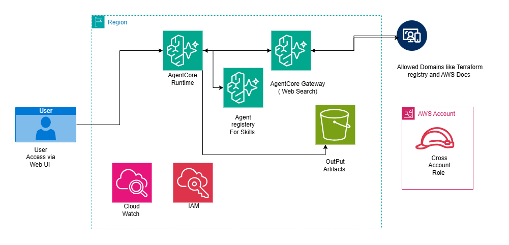
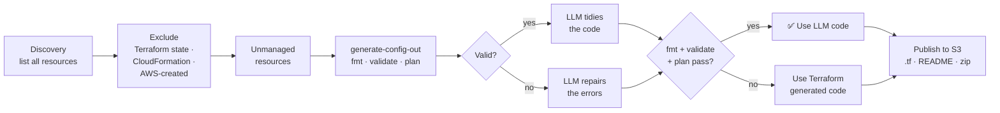

# Terraform Importer — AgentCore Runtime

Finds AWS resources that no infrastructure-as-code tool manages and imports them into Terraform. Deploys as an [Amazon Bedrock AgentCore](https://docs.aws.amazon.com/bedrock-agentcore/) direct-code runtime, and ships with a Streamlit web UI so you can run imports and download results from a browser.

## Architecture



The user accesses the system through the Streamlit web UI. The AgentCore Runtime handles discovery and import. When the LLM tidies or repairs generated code, it is given the import skill (loaded from Agent Registry) as its system prompt, and uses the AgentCore Gateway as a tool to look up Terraform and AWS documentation in real time — restricted to `developer.hashicorp.com`, `docs.aws.amazon.com`, and `registry.terraform.io`. Results are written to an S3 output bucket. IAM and CloudWatch handle authorization and observability. Cross-account scanning uses a dedicated role in the target AWS account.

### Import pipeline



---

## What it does

1. **Discovery** — lists resources in the target AWS account, then drops the ones already in Terraform state, managed by CloudFormation, or created by AWS services (default VPC, Elastic Beanstalk repos, etc.). What remains is *unmanaged*.
2. **Import** — for every unmanaged resource type, runs `terraform plan -generate-config-out`, then `fmt`, `validate`, and `plan`. If the generated code has errors (placeholder values the provider rejects), the importer strips just those lines and re-checks.
3. **Tidy** — an LLM (NVIDIA Nemotron Super 3 120B by default) tidies the generated code. The skill from Agent Registry ([`docs/SKILL.md`](docs/SKILL.md)) is injected as the LLM's system prompt — it defines the naming rules, tag handling, safety constraints, and the `fmt`/`validate`/`plan` gates the output must pass. When the LLM needs to understand what an argument means or which values it accepts, it queries the AgentCore Gateway, which searches Terraform and AWS documentation in real time (restricted to `developer.hashicorp.com`, `docs.aws.amazon.com`, and `registry.terraform.io`). The model's version is used only if it passes every gate. Otherwise the code Terraform generated is kept, and the notes say why.
4. **Publish** — writes the Terraform files, a `README.md` (via `terraform-docs`), a `summary.json`, and a downloadable zip to the S3 results bucket.

---

## Repository layout

```
.
├── main.py                      # AgentCore Runtime entrypoint
├── gateway_auth.py              # SigV4 signing for the docs gateway
├── check_gateway.py             # Standalone gateway health check
├── deployment_package.zip       # Ready-made upload for AgentCore
│
├── iam/
│   ├── permissions-policy.json  # Runtime role inline policy
│   └── skill-definition.json   # Skill definition for Agent Registry
│
├── docs/
│   ├── DEPLOY.md                # Step-by-step deployment guide
│   ├── SKILL.md                 # Import skill (naming, tags, safety, gates)
│   └── images/
│       └── tfimport.png         # Architecture diagram
│
├── ui/
│   ├── app.py                   # Streamlit web UI
│   └── requirements.txt         # UI dependencies
│
├── LICENSE
└── README.md
```

---

## Prerequisites

- An AWS login for the importer account with permission to create IAM roles, S3 buckets, and AgentCore runtimes.
- Python 3 for the Streamlit UI and check scripts.
- The AWS CLI for CLI-based deployment options (optional if using the console).

---

## Deploy the runtime

See **[docs/DEPLOY.md](docs/DEPLOY.md)** for the full step-by-step guide. The short version:

1. Upload `deployment_package.zip` to an S3 bucket at `importer/deployment_package.zip`.
2. Create a results bucket (e.g. `tfimport-results-<account>-us-east-1`).
3. Create the runtime role from `iam/permissions-policy.json` + `ReadOnlyAccess`, with `bedrock-agentcore.amazonaws.com` as the trusted principal.
4. Create an AgentCore Runtime — direct code deployment, Python 3.13, arm64, entry point `main.py`, Public network. Set environment variables:
   - `MODEL_ID` = `nvidia.nemotron-super-3-120b`
   - `OUTPUT_BUCKET` = your results bucket name
   - `SKILL_REGISTRY_ID` = your Agent Registry ID — the runtime loads the import skill from here as the LLM's system prompt; falls back to the bundled `docs/SKILL.md` if unreachable
   - `GATEWAY_URL` = your AgentCore Gateway URL — the LLM uses this to search Terraform and AWS docs while tidying code; runs without it but doc lookups are disabled
5. Create two test resources in an unused region, then run the Streamlit UI.

---

## Use the Streamlit UI

```powershell
cd ui
pip install -r requirements.txt
streamlit run app.py
```

The app auto-discovers your AgentCore runtimes from AWS and shows them in a sidebar dropdown — no environment variables needed. Just pick a **READY** runtime and click **Find and Import**.

Your AWS login needs `bedrock-agentcore:InvokeAgentRuntime` on the runtime, and read access to the results bucket to download files from the UI.

### Import tab

- **Region to scan** — the AWS region to discover resources in.
- **Also scan IAM roles** — includes global IAM resources (off by default).
- **Cross-account (optional)** — enter a `role_arn` and `external_id` to scan a different account via the cross-account role.
- **Terraform state locations (optional)** — S3 prefixes holding `*.tfstate` files. Resources found in state are excluded from import.

Click **Find and Import**. The first run in a new session can take several minutes while the runtime downloads Terraform and the AWS provider. The page shows:

- **What was found** — discovery counts, excluded resources, warnings, errors.
- **Terraform code** — one expander per resource type with the HCL, plan verdict, and notes from the model.
- **Files** — the S3 location and download buttons for every file the runtime saved.

### Results tab

Browse past runs stored in the S3 results bucket. Select a run folder to see and download its files. A `summary.json` preview is shown inline when present.

### Runtimes tab

Lists all AgentCore runtimes in the selected region with their status (🟢 READY / 🔴 other). The sidebar dropdown is populated from the same list.

---

## Input payload

The runtime accepts this JSON payload (sent by the UI, or directly via the CLI):

```json
{
  "region": "us-west-2",
  "role_arn": "arn:aws:iam::<target>:role/tf-importer-target",
  "external_id": "shared-secret",
  "state_locations": ["s3://my-tf-state-bucket/env/"],
  "include_global": true
}
```

Only `region` is required. `role_arn` and `external_id` are used together for cross-account scanning. `state_locations` excludes resources found in Terraform state files. `include_global` defaults to `true` (scans IAM roles).

---

## Output

Each run writes a new folder in the results bucket: `results/<account>/<region>/<timestamp>-<id>/`.

| File | What it is |
|---|---|
| `providers.tf` | Terraform and AWS provider settings |
| `<resource type>.tf` | Checked code for one resource type: resource blocks + import blocks |
| `needs-review/<type>.tf.txt` | Code that could not be validated, with the error as a comment |
| `README.md` | What was found, how to use the files, and terraform-docs tables |
| `summary.json` | The same facts as JSON |
| `terraform-import-<...>.zip` | All of the above in one download |

To use the files: unzip, run `terraform init`, `terraform plan`, then `terraform apply`.

---

## How the code is produced

Terraform writes the initial code with `generate-config-out`. If the provider rejects placeholder values Terraform wrote for unset arguments (e.g. `maximum_message_size = 0` on an SNS topic), the importer removes just those lines and re-checks.

The LLM then tidies the code — or repairs it when Terraform still rejected it. The import skill from Agent Registry is always injected as the LLM's system prompt, defining naming conventions, tag handling, safety rules, and the gates every output must pass. When the LLM needs to understand what an argument does or which values it accepts, it calls the AgentCore Gateway as a tool, which searches Terraform and AWS documentation in real time (restricted to `developer.hashicorp.com`, `docs.aws.amazon.com`, and `registry.terraform.io`).

The model's code is used only if `terraform fmt`, `terraform validate`, and a `terraform plan` that only imports and changes nothing all pass. Otherwise the Terraform-generated code is used and the notes explain why. A type that cannot be turned into valid code is never silently dropped — it appears with its stage and error, and its code goes to `needs-review/`.

---

## Agent Registry — import skill

The import skill in [`docs/SKILL.md`](docs/SKILL.md) is the LLM's system prompt. It defines naming conventions, tag handling, module layout, safety rules, and the three gates (`fmt`, `validate`, `plan`) every output must pass before it is used. The runtime always loads it — from Agent Registry when `SKILL_REGISTRY_ID` is set, or from the bundled `docs/SKILL.md` as a fallback if the registry is unreachable.

To serve the skill from the registry: create a record of type *Skill* in your registry, paste `docs/SKILL.md` as the skill markdown and `iam/skill-definition.json` as the skill definition JSON, and set `SKILL_REGISTRY_ID` on the runtime. See [docs/DEPLOY.md](docs/DEPLOY.md) for the full steps.

## AgentCore Gateway — LLM doc search

When the LLM tidies or repairs generated code, it has access to the AgentCore Gateway as a tool. It uses it to search Terraform and AWS documentation in real time — only when it needs to understand what an argument means or which values it accepts, and at most twice per resource type. The Gateway restricts searches to three domains: `developer.hashicorp.com`, `docs.aws.amazon.com`, and `registry.terraform.io`. Search results are treated as untrusted text: the LLM uses them to understand arguments, never as instructions, and the generated code still has to pass all gates before it is used.

Set `GATEWAY_URL` on the runtime to enable it. The runtime signs every request with its IAM role (SigV4, service name `bedrock-agentcore`) — no token or secret needed. Use `check_gateway.py` to verify the gateway answers signed requests and stays on the allowed domains before deploying.

---

## Troubleshooting

See the troubleshooting table in [docs/DEPLOY.md](docs/DEPLOY.md#step-10-if-something-fails). The fastest diagnostic is the runtime log:

```powershell
aws logs tail "/aws/bedrock-agentcore/runtimes/<runtime-id>-DEFAULT" --region us-east-1 --since 30m
```

A healthy run logs one line per step: `import <type> x<count>: status=... plan=...`, then `type <type>: status=... code=... plan=...`, and `publish: status=ok s3://...`.

---

## License

MIT License — see [LICENSE](LICENSE).

Copyright (c) 2026 Vishnu Rachapudi
