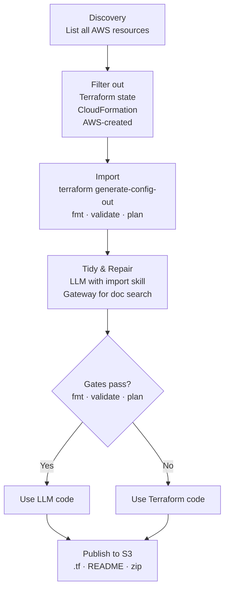
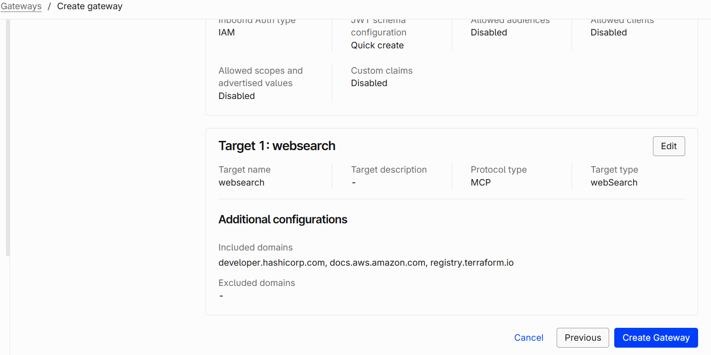
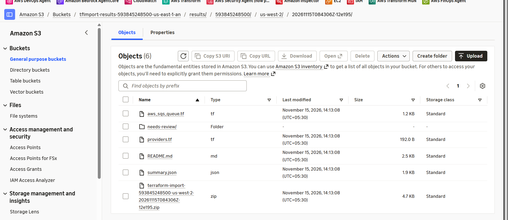
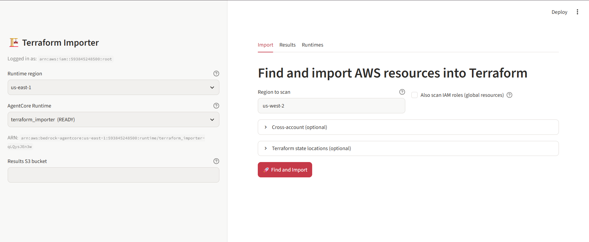

# From Unmanaged to Terraform in Minutes — Building an AgentCore Importer

*by aquavis12 — November 15, 2026*

---

Watch the tool in action:

📹 **[terraform-importer.mp4](https://videos-hackthon-593845248500-us-west-1-an.s3.us-west-1.amazonaws.com/terraform-importer.mp4)**

---

## The problem: drift you can't see

Every AWS account has them — resources clicked together in the console, a Lambda from a wizard, an SQS queue from a weekend prototype. They work, nobody knows exactly what they are, and no Terraform state file knows they exist.

I used the draw.io tool to map a live AWS account and found an LMS application with Cognito, API Gateway, Lambda, DynamoDB tables, and S3 buckets — all real, all running, none in Terraform.


Resources like `feedback-table` and the two session buckets are marked "Connected, not in scope (skipped)". That is the drift. And this is just one small application.

---

## Architecture

The tool is deployed as an Amazon Bedrock AgentCore Runtime with four stages:



- **Discovery** scans the account, filters out anything already in Terraform state, CloudFormation, or created by AWS itself.
- **Import** runs `terraform plan -generate-config-out` for every unmanaged resource type.
- **Tidy** sends the generated code to an LLM (NVIDIA Nemotron Super 3 120B). The LLM has the import skill as its system prompt and searches Terraform/AWS docs via the AgentCore Gateway when it needs to understand an argument.
- **Publish** saves validated Terraform files, a README (via terraform-docs), and a zip to S3.

---

## Key images

### 1. Architecture diagram


The runtime sits in your AWS account, discovers resources, calls the LLM to tidy the generated code, and writes results to S3. The import skill comes from Agent Registry, and the Gateway gives the LLM read-only access to documentation.

### 2. Streamlit UI



A web interface that auto-discovers your AgentCore runtime — no ARN to paste manually. Pick a region, optionally set cross-account details, and click **Find and Import**. The first run takes a few minutes (downloading Terraform), later runs finish in under a minute.

### 3. Results in S3



Each run creates a folder with:
- `providers.tf` — Terraform and AWS provider config
- `<resource>.tf` — Validated code for each type
- `needs-review/` — Code that failed validation (with error as comment)
- `README.md` — Generated by terraform-docs
- `summary.json` — Machine-readable run summary
- `terraform-import-*.zip` — Everything in one download

### 4. Lambda discovered



The `SQS-Processor` Lambda in `us-west-1` was found and imported — it was not in any Terraform state or CloudFormation stack. The LLM named it from the function's `Name` tag following the import skill's naming rules.

---

## How the LLM works

The model receives:
- Generated HCL from Terraform
- Import blocks for each resource ID
- The import skill as system prompt (from Agent Registry)
- Access to the Gateway as a tool for documentation lookup

It outputs cleaned Terraform code. That output is verified with `terraform fmt`, `terraform validate`, and a plan that only imports and changes nothing. Only if all three gates pass is the LLM's code used. Otherwise, Terraform's original output is kept and notes explain why.

The Gateway is restricted to three domains: `developer.hashicorp.com`, `docs.aws.amazon.com`, and `registry.terraform.io`. Search results are treated as untrusted text — the LLM uses them to understand arguments, never as instructions.

---

## What I learned

- **Registry ID vs Record ID** — The runtime needs the Registry ID in `SKILL_REGISTRY_ID`. A common mistake is using the Record ID from a record's page instead.
- **Gateway domain restrictions** — Without included domains, the Gateway lets the LLM search anywhere. Set `developer.hashicorp.com`, `docs.aws.amazon.com`, and `registry.terraform.io` explicitly.
- **First run is slow** — The runtime downloads Terraform (~50 MB) and the AWS provider (~700 MB) on cold start. Later runs in the same session reuse them.
- **Some resources need manual review** — SNS topics, for example, trigger provider errors on placeholder values like `maximum_message_size = 0`. Those go to `needs-review/` with the error as a comment.

---

## Try it yourself

The full source is at [github.com/aquavis12/tfimport](https://github.com/aquavis12/tfimport). The deployment guide is in [`docs/DEPLOY.md`](DEPLOY.md).

```powershell
# Quick start
cd ui
pip install -r requirements.txt
streamlit run app.py
```

The app discovers your AgentCore runtime automatically. Set `OUTPUT_BUCKET`, `SKILL_REGISTRY_ID`, and `GATEWAY_URL` on the runtime, then run an import from the UI.

---

*MIT License — Copyright (c) 2026 aquavis12*