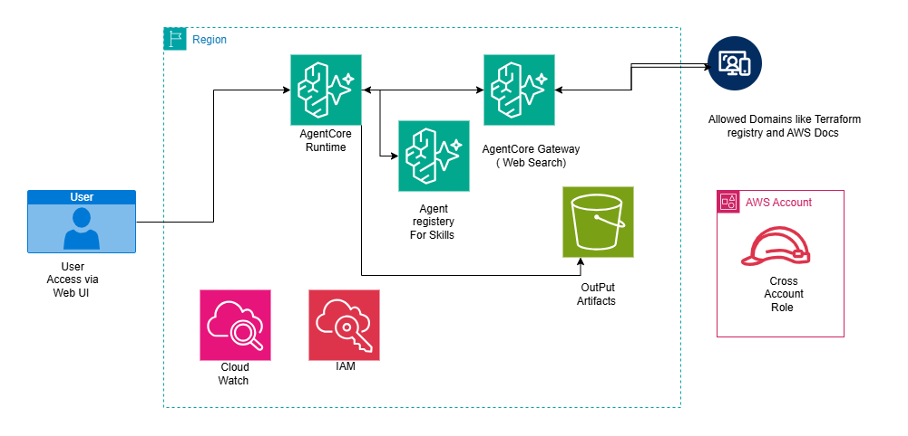
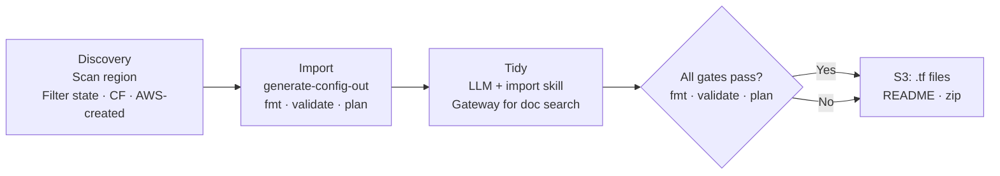
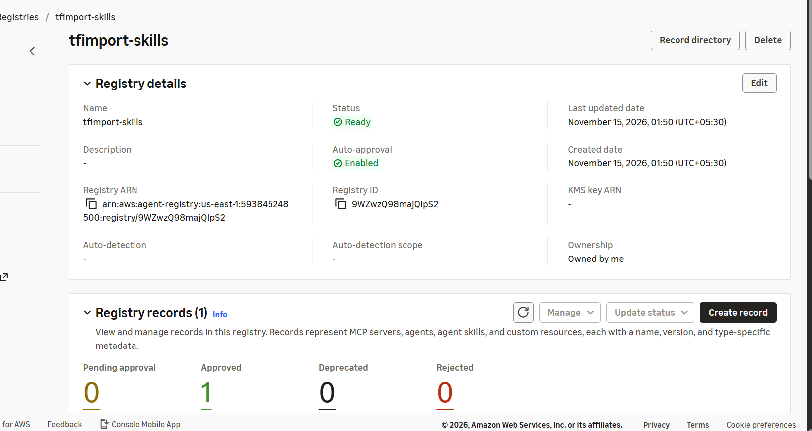
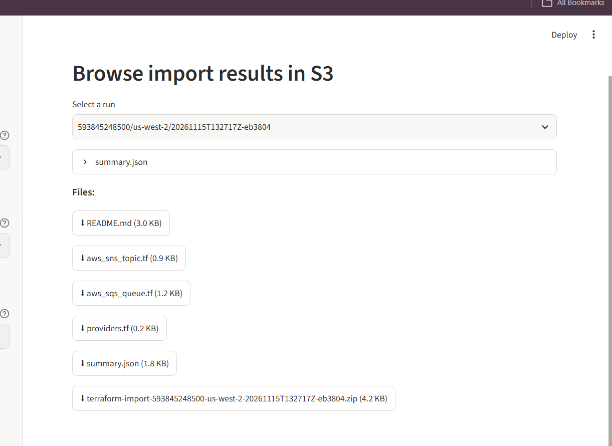
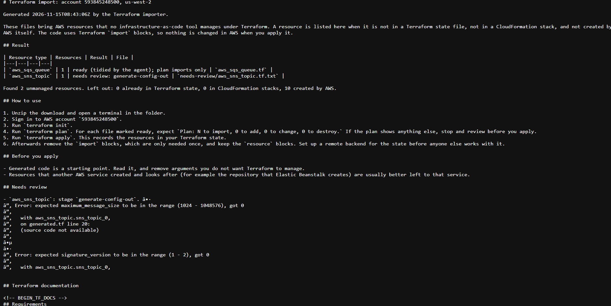

# Automating Terraform Imports with Amazon Bedrock AgentCore

*by aquavis12 · November 15, 2026*

> 📹 **[Watch the demo](https://videos-hackthon-593845248500-us-west-1-an.s3.us-west-1.amazonaws.com/terraform-importer.mp4)** · 💻 **[github.com/aquavis12/tfimport](https://github.com/aquavis12/tfimport)**

---

## The problem

IaC has always been the right way to manage cloud infrastructure. The goal is simple: every AWS resource should live in a Terraform state file so the team can review changes, enforce standards, and avoid configuration drift.

The reality is messier. Resources get clicked together in the console, created by service wizards, or spun up during a proof of concept. `terraform import` can bring them under management — but only one resource at a time. For each one you look up the import ID, write the resource block by hand, run the import, fix the generated config, and repeat. For twenty resources across five types that is an afternoon of work. For a whole account region it simply never happens.

`terraform plan -generate-config-out` changed that. It writes resource blocks automatically for a list of IDs. But it still needs discovery (which resources exist and are not already managed?), and the generated code sometimes has provider errors that need fixing. That is the gap this tool fills.

---

## How it is built

The tool runs as an Amazon Bedrock AgentCore Runtime — a Python zip deployed directly, no container needed.





**Discovery** lists every resource in the target region, then drops anything already in a Terraform state file, managed by CloudFormation, or created by AWS itself (default VPC, service-managed repos). What remains is genuinely unmanaged.

**Import** runs `terraform plan -generate-config-out` for each type, then `fmt`, `validate`, and `plan`. If the provider rejects placeholder values Terraform wrote (e.g. `maximum_message_size = 0` on an SNS topic), the importer strips those lines and re-checks.

**Tidy** sends the generated code to NVIDIA Nemotron Super 3 120B via Amazon Bedrock. The LLM uses the import skill from Agent Registry as its system prompt — naming conventions, tag rules, safety constraints, and the three gates every output must pass. When it needs to understand an argument it calls the AgentCore Gateway, which searches Terraform and AWS documentation restricted to three allowed domains. The model's output is used only if `fmt`, `validate`, and an import-only plan all pass. Otherwise Terraform's output is kept.

**Publish** saves validated `.tf` files, a terraform-docs README, and a zip to S3.

The import skill lives in Agent Registry so it can be updated without rebuilding the zip:



---

## Running it

The Streamlit UI auto-discovers your AgentCore runtimes from the AWS control plane — no ARN to paste. Pick a region, click **Find and Import**.


The first run downloads Terraform and the AWS provider (~few minutes). Later runs in the same session finish in under a minute.

---

## The result

After the run the Results tab lets you browse past runs and download files directly from the browser:



Each run produces a timestamped folder in S3 with everything needed to bring the resources under Terraform:



The SQS queue passed all three gates and is ready to apply. The SNS topic hit a provider error on placeholder values and went to `needs-review/` with the error as a comment — never silently dropped.

To use the output:

```bash
unzip terraform-import-*.zip
terraform init
terraform plan    # N to import, 0 to add, 0 to change, 0 to destroy
terraform apply
```

That is it. Resources that lived outside IaC are now in Terraform state. The import blocks are only needed once — after `apply`, remove them and keep the resource blocks.

---

*MIT License · Copyright © 2026 aquavis12*
